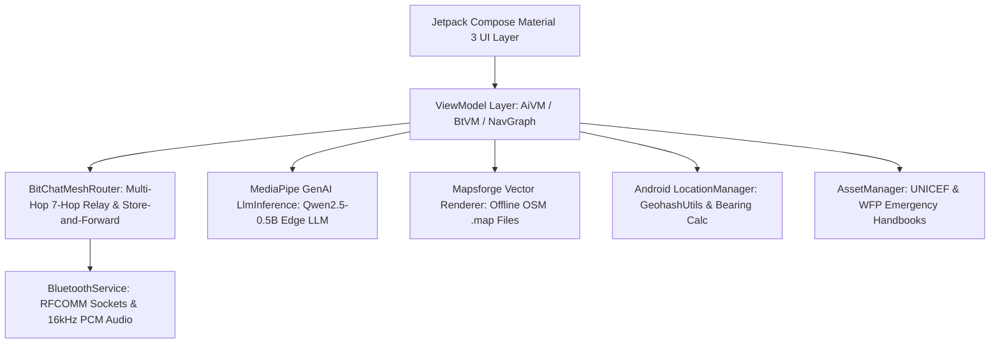

# SurvivE // Emergence AI

> **Zero-Infrastructure, Offline-First Emergency Survival & Off-Grid Tactical Communications Operating Platform for Android**

[-3DDC84.svg?style=flat&logo=android)](https://www.android.com/)
[](https://kotlinlang.org/)
[](https://developer.android.com/jetpack/compose)
[-FF6F00.svg?style=flat&logo=google)](https://ai.google.dev/edge/mediapipe/solutions/genai/llm_inference)
[](https://github.com/mapsforge/mapsforge)
[]()

---

## 📖 Complete Documentation Suite

Comprehensive technical engineering documents are maintained in the [`docs/`](file:///C:/Users/umart/OneDrive/Desktop/SurvivE/docs/) directory:

| Document | Description | Direct File Link |
|---|---|---|
| **System Design Document** | High-level requirements, component decomposition, user flows, and subsystem specifications | [DESIGN_DOCUMENT.md](file:///C:/Users/umart/OneDrive/Desktop/SurvivE/docs/DESIGN_DOCUMENT.md) |
| **Software Architecture Document** | Multi-tier MVVM architecture, UDF patterns, concurrency models, threading, and mesh topologies | [ARCHITECTURE_DOCUMENT.md](file:///C:/Users/umart/OneDrive/Desktop/SurvivE/docs/ARCHITECTURE_DOCUMENT.md) |
| **Features Specification** | Complete functional breakdown of Emergence AI, BitChat mesh, PTT Walkie-Talkie, Radar, and Maps | [FEATURES_DOCUMENT.md](file:///C:/Users/umart/OneDrive/Desktop/SurvivE/docs/FEATURES_DOCUMENT.md) |
| **Setup & Developer Guide** | Prerequisites, Gradle build commands, ADB deployment, and asset staging procedures | [SETUP_DOCUMENT.md](file:///C:/Users/umart/OneDrive/Desktop/SurvivE/docs/SETUP_DOCUMENT.md) |
| **Implementation Roadmap** | 5-phase strategic engineering plan (BLE mesh, E2E crypto, multimodal vision, LoRa radio interop) | [IMPLEMENTATION_ROADMAP.md](file:///C:/Users/umart/OneDrive/Desktop/SurvivE/docs/IMPLEMENTATION_ROADMAP.md) |
| **Security & Threat Model** | Threat vectors, RF interception defense, Android sandbox isolation, and FileProvider rules | [SECURITY_DOCUMENT.md](file:///C:/Users/umart/OneDrive/Desktop/SurvivE/docs/SECURITY_DOCUMENT.md) |
| **Testing & QA Strategy** | Local JUnit 4 unit tests, Compose UI tests, and multi-device hardware field validation protocols | [TESTING_DOCUMENT.md](file:///C:/Users/umart/OneDrive/Desktop/SurvivE/docs/TESTING_DOCUMENT.md) |

---

## ⚡ What is SurvivE?

**SurvivE** is an Android mobile platform engineered to preserve human life and coordinate rescue operations during complete infrastructure blackouts. When cellular networks collapse, electrical grids fail, or satellite uplinks are blocked, SurvivE transforms standard Android smartphones into **autonomous, peer-to-peer survival nodes**.

### 🌟 Core Capabilities
1. **Emergence AI (100% On-Device Large Language Model):**
   - Runs `Qwen2.5-0.5B-Instruct` locally via Google MediaPipe GenAI / LiteRT.
   - Provides instant, step-by-step guidance for medical triage, water purification, wilderness navigation, and chemical hazards with zero internet connectivity.
2. **BitChat Decentralized Off-Grid Mesh Communication:**
   - Multi-hop packet relaying (up to 7 hops) over Bluetooth RFCOMM without cellular towers or Wi-Fi routers.
   - 200-message LRU loop prevention and store-and-forward queueing for out-of-range peers.
3. **Tactical Push-to-Talk (PTT) Walkie-Talkie:**
   - Real-time 16kHz 16-bit PCM half-duplex voice streaming between connected nodes with dynamic pulse transmission feedback.
4. **Spatial Situational Awareness & Radar HUD:**
   - Custom Jetpack Compose Canvas radar displaying nearby peers on calibrated concentric rings (10m, 50m, 100m, 500m) using GPS Geohash and RSSI path-loss distance algorithms.
5. **Offline Vector Maps (Mapsforge):**
   - Renders OpenStreetMap `.map` vector tiles locally with street-level detail, coordinate centering, and custom map import.
6. **Pre-Bundled Humanitarian Disaster Handbooks:**
   - Includes full, uncompressed field manuals from **UNICEF** and the **World Food Programme (WFP)** viewable via secure `FileProvider`.
7. **Civil Defense Hardware FM Tuner:**
   - Direct intent launcher for native hardware FM radio chips across Qualcomm, Samsung, Xiaomi, Motorola, MediaTek, and other OEMs.

---

## 🏗️ Architecture at a Glance



---

## 🚀 Quick Start Guide

### 1. Requirements
- Android Studio Ladybug (2024.2.1+) or newer
- JDK 11 or JDK 17
- Physical Android device running Android 10 (API 29) to Android 16 (API 36)

### 2. Build Debug APK
```bash
# Clone the repository
git clone https://github.com/example/survive.git
cd SurvivE

# Build APK via Gradle
.\gradlew.bat assembleDebug   # Windows
./gradlew assembleDebug       # macOS / Linux
```

### 3. Deploy to Device
```bash
.\gradlew.bat installDebug
```

### 4. Stage Offline Assets
- **Emergence AI Model:** In the app, navigate to **AI** -> tap **"Download from Repository"** to obtain `qwen2_5_0_5b.task` (~380 MB), then tap **"Select Model File"** to stage it.
- **Offline Maps:** Download desired regional `.map` files from [Mapsforge Maps](https://download.mapsforge.org/maps/v5/) and import them in the **Locator** -> **Offline Map** tab.

---

## 📱 Application Screens

| Screen | Route | Description |
|---|---|---|
| **Home** | `home` | Mission dashboard with live GPS coordinates, timezone, Geohash, quick service grid, and FM launcher |
| **Manual** | `manual` | Bundled UNICEF/WFP disaster manuals viewer and emergency contacts manager |
| **Emergence AI** | `ai` | Edge LLM chat interface, model staging HUD, and quick triage prompt chips |
| **Locator** | `locator` | Dual-mode navigation: BitChat Peer Radar HUD & Mapsforge offline vector maps |
| **Bluetooth** | `bluetooth` | PTT Walkie-Talkie, BitChat mesh messaging, and paired/discovered device management |
| **Emergency** | `emergency` | National emergency hotlines and personal ICE contact quick dialer |

---

## 🛡️ Security & Privacy Principles

- **Zero Cloud Leakage:** All computation, text generation, and voice streaming occurs locally on device hardware.
- **Zero Telemetry:** No user analytics, session cookies, tracking SDKs, or cloud logging.
- **Volatile Storage:** Mesh messages exist strictly in volatile application memory (`StateFlow`) and are purged upon app exit.
- **No Account Required:** Fully functional immediately after installation with zero sign-in or authentication requirements.

---

## 📄 License
SurvivE is open-source software built for humanitarian, disaster relief, and emergency coordination purposes.
