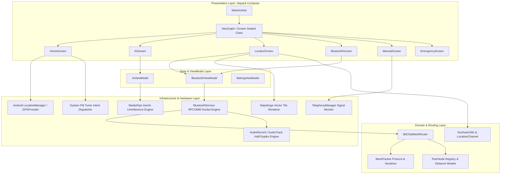
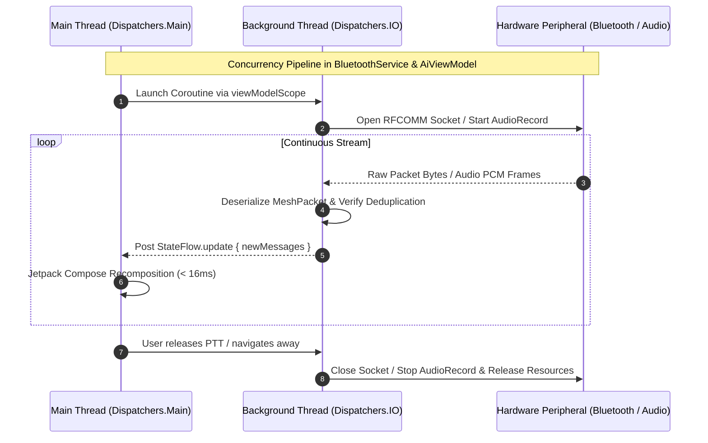
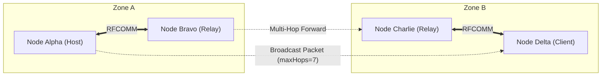
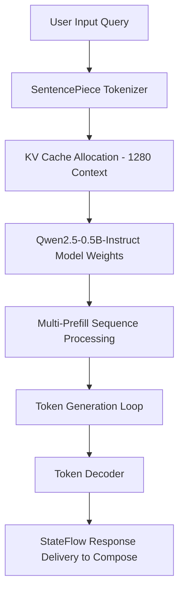

# SurvivE // Emergence AI — Software Architecture Document (SAD)

## 1. Architectural Style & Architectural Pattern

SurvivE follows the **Modern Android Architecture** paradigm recommended by Google, structured around:
- **Unidirectional Data Flow (UDF)**: Events flow upward from Composables to ViewModels; state flows downward as immutable `StateFlow` streams.
- **Model-View-ViewModel (MVVM)**: Strict separation of UI rendering (Compose), presentation logic (`ViewModel`), and domain services (`BluetoothService`, `BitChatMeshRouter`, `LlmInference`).
- **Reactive State Management**: Kotlin Coroutines and `kotlinx.coroutines.flow.StateFlow` provide non-blocking asynchronous state updates.
- **Offline Clean Layering**: Hardware peripherals (Bluetooth adapter, microphone, GPS, cellular telemetry) are wrapped in encapsulated service layers with zero tight coupling to UI components.

---

## 2. Multi-Layered Architecture Diagram



---

## 3. Package & Directory Structure

```text
com.example.myapplication/
├── MainActivity.kt                      # Single activity container & bottom navigation bar
├── UiState.kt                           # Generic UI state wrappers
├── BakingScreen.kt                      # Legacy starter screen (non-active)
├── BakingViewModel.kt                   # Legacy starter viewmodel (non-active)
├── bitchat/                             # Off-grid mesh protocol implementation
│   ├── location/
│   │   ├── GeohashUtils.kt             # Lat/Lon to Geohash encoder/decoder, Haversine & bearing
│   │   └── LocationChannel.kt          # Channel abstraction for location-based channels
│   ├── mesh/
│   │   ├── BitChatMeshRouter.kt        # Multi-hop packet routing, deduplication & peer presence
│   │   └── PeerNode.kt                 # Active peer model, hop count, RSSI, distance
│   └── protocol/
│       ├── MeshPacket.kt               # Binary wire protocol serialization/deserialization
│       └── PacketType.kt               # Packet classification enum (TEXT, VOICE, ANNOUNCE, etc.)
├── bluetooth/                           # Low-level Bluetooth hardware orchestration
│   ├── BluetoothService.kt             # RFCOMM server/client sockets, discovery, audio streaming
│   └── BluetoothViewModel.kt           # StateFlow bridges for paired/discovered devices & peers
├── manual/                              # Offline documentation modules
│   └── ZimReader.kt                    # Offline Wiki stub (deprecated)
└── ui/                                  # Presentation and theme subsystem
    ├── ai/
    │   ├── AiScreen.kt                 # Model importer HUD & interactive chat interface
    │   └── AiViewModel.kt              # MediaPipe LlmInference orchestration & file staging
    ├── components/
    │   └── LocatorBar.kt               # Live GPS coordinates and geohash status card
    ├── navigation/
    │   ├── NavGraph.kt                 # NavHost composable with single-top navigation rules
    │   └── Screen.kt                   # Sealed class defining routes, titles, and icons
    ├── screens/
    │   ├── BluetoothScreen.kt          # PTT walkie-talkie, device discovery & mesh messaging
    │   ├── EmergencyScreen.kt          # Container for emergency contacts & hotlines
    │   ├── HomeScreen.kt               # Dashboard with quick links, coordinates, and FM radio launcher
    │   ├── LocatorScreen.kt            # Radar HUD Canvas & Mapsforge offline map viewer
    │   └── ManualScreen.kt             # Bundled PDF viewer & emergency contacts tab
    └── theme/
        ├── Color.kt                    # Tactical dark/light theme palettes
        ├── Theme.kt                    # Material 3 dynamic color configuration
        └── Type.kt                     # Typography hierarchies
```

---

## 4. Concurrency & Threading Model

SurvivE utilizes structured concurrency to guarantee non-blocking UI rendering and prevent Application Not Responding (ANR) conditions under constrained hardware conditions.



### 4.1 Dispatcher Strategy
- **`Dispatchers.Main`**: Drives Compose recomposition, user touch feedback, and UI event observation.
- **`Dispatchers.IO`**: Handles heavy file I/O (model importing, PDF streaming to cache), Bluetooth RFCOMM socket read/write loops, and Mapsforge tile decoding.
- **Dedicated Coroutines & Background Jobs**:
  - `serverJob`: Maintains `BluetoothServerSocket.accept()` listening loop.
  - `listeningJob`: Reads from active `BluetoothSocket.inputStream` continuously.
  - `heartbeatJob`: Emits periodic `ANNOUNCE` packets with GPS telemetry.
  - `audioSendJob`: Streams PCM frames during active PTT.

---

## 5. Mesh Networking & Routing Architecture

### 5.1 Topology
BitChat forms a **dynamic, decentralized, ad-hoc mobile mesh network (MANET)** over standard Bluetooth. Devices act simultaneously as end-user terminals and packet relays.



### 5.2 Store-and-Forward Routing Engine
- **Deduplication:** An LRU cache (`seenMessageIds`) holding the last 200 message identifiers prevents infinite broadcast storms and routing loops.
- **Hop Count Control:** Each packet carries `hopCount` and `maxHops` (default 7). Packets with `hopCount >= maxHops` are discarded.
- **Offline Message Queuing:** When a destination node is unreachable, packets are stored in `_offlineQueue`. When the target or a candidate relay node appears in discovery or connects, `flushOfflineQueueForPeer()` automatically replays queued packets.

---

## 6. On-Device AI Engine Architecture

### 6.1 MediaPipe GenAI / LiteRT Integration


### 6.2 Memory & Compute Isolation
The AI engine runs entirely within the application sandbox. The model is loaded via a dedicated worker thread to prevent heap spikes. Memory allocations for model weights (~350MB) are kept in native memory buffers managed by the MediaPipe C++ runtime, minimizing Android Dalvik/ART GC pressure.

---

## 7. Storage & Data Architecture

| Category | Storage Medium | Access Mechanism | Persistence / Lifetime |
|---|---|---|---|
| **Humanitarian Manuals** | APK Compressed Assets (`assets/*.pdf`) | `AssetManager.open()` | Permanent (Bundled in APK) |
| **Active Manual Cache** | App Internal Cache (`cacheDir/manuals/`) | `FileProvider` via Content URI | Transient (Cleared on app cache wipe) |
| **AI LLM Weights** | App Internal Storage (`filesDir/qwen2_5_0_5b.task`) | Direct File Descriptor via MediaPipe | Persistent across updates |
| **Offline Vector Maps** | External / Internal Storage (`filesDir/maps/` or SAF) | Mapsforge `MapFile` binary reader | Persistent user-selected files |
| **Mesh Messages** | In-Memory Reactive Flows (`StateFlow<List<String>>`) | Volatile memory | Ephemeral (Session lifespan for tactical security) |
| **Mesh Queue** | In-Memory `StateFlow<List<MeshPacket>>` | Volatile memory | Flushed upon transmission |

---

## 8. Cross-Cutting Concerns

### 8.1 Error Handling & Resilience
- **Bluetooth State Transitions:** Broadcast receivers actively listen for `BluetoothAdapter.ACTION_STATE_CHANGED`. Disconnections gracefully reset UI states without crashing active jobs.
- **Graceful Permission Handling:** Accompanist permissions gracefully block feature tabs until required runtime permissions (`ACCESS_FINE_LOCATION`, `BLUETOOTH_CONNECT`, `RECORD_AUDIO`) are granted by the user.
- **File Picker Resiliency:** Atomic file copy through temporary buffers (`$MODEL_FILENAME.tmp`) ensures corrupt or partial imports never overwrite an existing working model.
