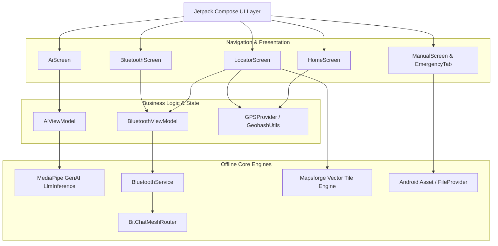
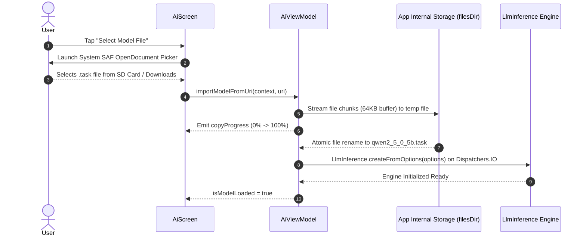
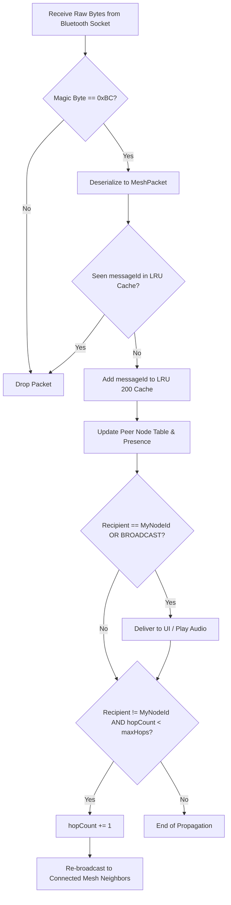

# SurvivE // Emergence AI — System Design Document (SDD)

## 1. Executive Summary & Vision

**SurvivE** (incorporating **Emergence AI**) is an offline-first, mission-critical emergency survival and off-grid communications platform developed for Android (API 29 to 36). Engineered specifically for scenarios involving total infrastructure blackout—such as natural disasters, grid collapse, remote expeditions, cellular jamming, or humanitarian emergencies—SurvivE eliminates dependencies on centralized cloud backends, cell towers, satellite links, and external API gateways.

The platform unifies four essential emergency capabilities into a cohesive, zero-latency mobile tool:
1. **Decentralized Multi-Hop Mesh Communications (BitChat):** P2P text and PTT (Push-To-Talk) walkie-talkie audio broadcasting over Bluetooth RFCOMM with store-and-forward relaying.
2. **On-Device Artificial Intelligence (Emergence AI):** Zero-cloud, local inference of quantized LLMs (Qwen2.5-0.5B-Instruct) via MediaPipe GenAI / LiteRT for first-aid triage, survival procedures, and chemical/biological hazards.
3. **Autonomous Navigation & Geolocation (Locator):** Mathematical peer distance radar driven by RF RSSI path-loss and GPS Geohash triangulation alongside offline Mapsforge vector mapping.
4. **Resilient Field Survival Repository (Manual & Emergency):** Bundled humanitarian disaster manuals (UNICEF, WFP), cellular telemetry monitoring, one-touch emergency contact dispatch, and analog FM hardware tuner triggers.

---

## 2. Design Principles & Goals

### 2.1 Core Engineering Principles

| Principle | Technical Definition & Implementation |
|---|---|
| **Zero External Cloud Dependency** | All primary functions (inference, routing, mapping, PDF reading) operate with cellular and Wi-Fi disabled. Network requests are strictly forbidden during runtime operations. |
| **Fail-Safe & Graceful Degradation** | If GPS is denied, the application falls back to RSSI-based proximity estimation. If Bluetooth is unbonded, it triggers dynamic discovery. If offline vector maps are missing, the peer radar remains operational. |
| **Battery & Energy Conservation** | Emergency devices operate under extreme power constraints. Threads are dispatched via coroutines with structured lifecycle scoping (`viewModelScope`), audio recording is activated only during Push-to-Talk (half-duplex), and Bluetooth discovery operates with bounded timeouts. |
| **Low Latency & High Responsiveness** | UI rendering on Jetpack Compose runs at 60/120 FPS. Radar sweep animations use hardware-accelerated Canvas drawing with no heavy DOM or WebView bloat for primary telemetry. |
| **Human-Centric Emergency Ergonomics** | High-contrast visual tokens, dark-mode-first aesthetic (slate, deep emerald, vivid orange warnings), large tap targets (>48dp), and one-touch PTT walkie-talkie triggers designed for stress environments. |

---

## 3. High-Level Component & Subsystem Design



---

## 4. Subsystem Deep-Dive

### 4.1 Emergence AI Subsystem

#### 4.1.1 Architectural Overview
The on-device intelligence subsystem operates via `com.google.mediapipe.tasks.genai.llminference.LlmInference`. Unlike web-based wrappers that depend on cloud endpoints (OpenAI, Gemini REST), Emergence AI executes directly on the device CPU/GPU utilizing a pre-quantized LiteRT `.task` model.

#### 4.1.2 Model Specifications
- **Target Architecture:** Qwen2.5-0.5B-Instruct
- **Quantization:** Q8_EKV1280 (8-bit quantization with extended KV cache buffer)
- **Container Format:** MediaPipe `.task` archive containing model weights, sentencepiece tokenizer, and execution metadata
- **File Name:** `qwen2_5_0_5b.task`
- **Internal Storage Path:** `context.filesDir/qwen2_5_0_5b.task`
- **Storage Footprint:** ~350 MB to 500 MB

#### 4.1.3 Storage & Ingestion Workflow


#### 4.1.4 System Prompt & Response Conditioning
Emergence AI enforces strict field conditioning:
```text
You are Emergence AI, an offline, safety-critical field assistant designed for survival strategies, emergency triage, outdoor navigation, and daily practical commerce.

Core Directives:
1. Conciseness First: Provide actionable, step-by-step instructions. Avoid filler, disclaimers, or conversational pleasantries.
2. Safety & Ground Truth: If an edible plant, chemical, or medical procedure is dangerous or uncertain, advise against it directly. Never guess dosages.
3. Resourcefulness: Focus on low-tech, field-expedient solutions using commonly scavenged or commercial daily items.
4. Formatting: Use numbered steps for procedures, bold text for critical warnings.
```

---

### 4.2 BitChat Off-Grid Mesh Communication Subsystem

#### 4.2.1 Protocol Framing (`MeshPacket`)
The BitChat binary packet format ensures minimal overhead over low-bandwidth Bluetooth RFCOMM streams.

| Field | Type | Size | Description |
|---|---|---|---|
| `magicByte` | `Byte` | 1 Byte | Packet identifier: `0xBC` |
| `version` | `Byte` | 1 Byte | Protocol version (currently `1`) |
| `packetType` | `Byte` | 1 Byte | Enum: `TEXT(0x01)`, `VOICE(0x02)`, `ANNOUNCE(0x03)`, `PING(0x04)`, `ACK(0x05)`, `ROUTE_REQ(0x06)`, `ROUTE_REP(0x07)` |
| `senderId` | `UTF String` | Variable | Unique node ID (e.g., `PIXE-A3F1`) |
| `recipientId` | `UTF String` | Variable | Target node ID or `"BROADCAST"` |
| `messageId` | `UTF String` | 8 Chars | UUID-generated unique packet fingerprint |
| `hopCount` | `Int` | 4 Bytes | Number of intermediate relays traversed |
| `maxHops` | `Int` | 4 Bytes | Maximum hop threshold (default: `7`) |
| `timestamp` | `Long` | 8 Bytes | Epoch millisecond timestamp |
| `latitude` | `Double` | 8 Bytes | WGS84 Latitude coordinate (optional, 0.0 if null) |
| `longitude` | `Double` | 8 Bytes | WGS84 Longitude coordinate (optional, 0.0 if null) |
| `geohash` | `UTF String` | Variable | 7-character Geohash string |
| `payload` | `UTF String` | Variable | Message text, peer metadata, or Base64 audio stream |

#### 4.2.2 Multi-Hop Routing & Deduplication Algorithm


#### 4.2.3 Distance Estimation via RSSI Log-Distance Path-Loss
The mesh router estimates peer distance without active ranging hardware using the log-distance path loss model:
$$d = 10^{\frac{\text{MeasuredPower} - \text{RSSI}}{10 \cdot n}}$$
- $\text{MeasuredPower} = -69 \text{ dBm}$ (calibrated RSSI at 1 meter distance)
- $n = 2.0$ (path-loss exponent for unobstructed free-space RF propagation)

---

### 4.3 Half-Duplex Push-to-Talk (PTT) Audio Engine

#### 4.3.1 Audio Specifications
- **Sampling Rate:** 16,000 Hz (16 kHz)
- **Encoding:** PCM 16-Bit Mono
- **Buffer Allocation:** Calculated dynamically via `AudioRecord.getMinBufferSize(16000, CHANNEL_IN_MONO, ENCODING_PCM_16BIT)`
- **Audio Routing:**
  - Recording: `MediaRecorder.AudioSource.MIC`
  - Playback: `AudioTrack` initialized with `STREAM_MUSIC` in `MODE_STREAM`

#### 4.3.2 PTT Workflow
1. User presses and holds the **"HOLD TO TALK"** button on [`BluetoothScreen.kt`](file:///C:/Users/umart/OneDrive/Desktop/SurvivE/app/src/main/java/com/example/myapplication/ui/screens/BluetoothScreen.kt).
2. The UI enters active pulse animation (`pulseAlpha` tween), notifying the user of active transmission.
3. `BluetoothService.startVoice(true)` initializes `AudioRecord` in a dedicated background coroutine on `Dispatchers.IO`.
4. Audio buffers are captured in real-time, converted into Base64 or serialized byte payloads, encapsulated in `MeshPacket(packetType = PacketType.VOICE)`, and transmitted across active sockets.
5. On the receiving peer, `BluetoothService.playIncomingVoicePacket()` decodes the payload and streams PCM bytes directly into `AudioTrack.write()`.
6. Releasing the button triggers `BluetoothService.startVoice(false)`, releasing recording resources immediately to preserve battery.

---

### 4.4 Geolocation, Radar & Vector Mapping (Locator)

#### 4.4.1 Dual-View Architecture
The Locator provides two switchable operational modes:
1. **BitChat Off-Grid Mesh Radar:**
   - Visualizes all active mesh peers on a circular HUD display.
   - Computes angular position relative to user position using spherical trigonometry:
     $$\theta = \text{atan2}(\sin(\Delta\lambda)\cos(\phi_2), \cos(\phi_1)\sin(\phi_2) - \sin(\phi_1)\cos(\phi_2)\cos(\Delta\lambda))$$
   - Computes distance using Haversine formula and clamps rendering within 10m to 500m concentric range rings.
   - Displays a dynamic 360-degree rotating radar sweep using `Brush.sweepGradient`.
2. **Offline Vector Maps (Mapsforge):**
   - High-performance, low-memory OpenStreetMap vector tile rendering via Mapsforge 0.20.0.
   - Renders `.map` files directly from device storage with no internet connectivity.
   - Built-in map file manager allowing users to import country/regional `.map` files via Android Storage Access Framework (SAF).

---

### 4.5 Survival Manuals & Field Knowledge Base

#### 4.5.1 Bundled Humanitarian Handbooks
SurvivE embeds authoritative humanitarian guidelines directly in the application APK assets (`app/src/main/assets/`):
- `emergencyhandbook.pdf`: **UNICEF Emergency Field Handbook** (Disaster operations, emergency water, child protection)
- `WFP-0000037858.pdf`: **WFP Emergency Preparedness Manual** (Camp setup, nutrition, emergency storage)
- `1546247785837-Logistic Cluster_Operational Guidelines.pdf`: **WFP Logistics Manual** (Transport fleets, supply chains)
- `1DDB64518AD4C6D4C1256C7C0039EF61-wfp-pocketbook-jul02.pdf`: **WFP Humanitarian Response Manual** (Triage & crisis response)

#### 4.5.2 Zero-Leak PDF Delivery
PDF documents are extracted from Android APK assets into application private cache directory (`context.cacheDir/manuals/`), and exposed to system PDF viewers via a hardened `FileProvider` with read-only URI permissions (`Intent.FLAG_GRANT_READ_URI_PERMISSION`). No sensitive storage permissions (`MANAGE_EXTERNAL_STORAGE`) are requested.

---

## 5. Technology Stack Summary

| Layer | Component / Library | Version | Rationale |
|---|---|---|---|
| **OS / Runtime** | Android SDK | Min: 29, Target: 36, Compile: 36.1 | Modern Android capabilities with backward compatibility to Android 10 |
| **Language** | Kotlin | 2.0.21 | Type-safety, coroutines, and native Jetpack Compose compiler support |
| **UI Framework** | Jetpack Compose + Material 3 | BOM 2024.09.00 | Declarative UI, reactive state binding, hardware-accelerated rendering |
| **Navigation** | Jetpack Navigation Compose | 2.8.5 | Single-activity decoupled navigation graph |
| **Permissions** | Accompanist Permissions | 0.36.0 | Modern declarative permission request handling in Compose |
| **On-Device AI** | Google MediaPipe Tasks GenAI | 0.10.14 | Hardware-accelerated on-device LLM inference (LiteRT) |
| **Offline Mapping** | Mapsforge Core / Android / Themes | 0.20.0 | Binary OSM vector tile rendering with zero network dependency |
| **Mesh Transport** | Bluetooth RFCOMM + BLE Discovery | Native Android API | Standard hardware interoperability across Android OEMs |
| **Audio I/O** | `AudioRecord` & `AudioTrack` | Native Android Media | Low-overhead raw PCM streaming for half-duplex PTT |
