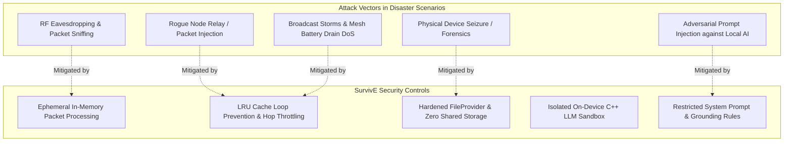

# SurvivE // Emergence AI — Security & Threat Modeling Document

## 1. Security Architecture & Threat Model

In catastrophic emergency, wilderness, or civil blackout situations, communication networks face extreme security risks including hostile surveillance, RF spectrum jamming, malicious misinformation, and opportunistic device compromise.

SurvivE is engineered following **Defense-in-Depth** and **Zero-Trust Local Execution** principles.



---

## 2. Threat Analysis & Mitigations

### 2.1 Radio Frequency (RF) Interception & Eavesdropping
- **Threat:** Malicious actors in proximity with software-defined radios (SDR) or listening devices can capture Bluetooth packets.
- **Current State:** Broadcast packets (chat and radar coordinates) are sent in open binary format to facilitate rapid ad-hoc rescue discovery by any surviving party.
- **Mitigation & Roadmap:** 
  - Direct point-to-point communications are isolated to paired/bonded RFCOMM sockets.
  - Phase 2 roadmap introduces the **Noise Protocol (Noise_XX)** using Curve25519 key exchange, ensuring end-to-end authenticated encryption (AEAD) with forward secrecy for all non-emergency directed packets.

### 2.2 Denial of Service (DoS) & Broadcast Storms
- **Threat:** A compromised or rogue node could broadcast flood packets, forcing all nearby nodes to exhaust their battery relaying packets.
- **Mitigations Implemented:**
  1. **Strict Hop-Limit (TTL):** Every packet enforces a hard maximum hop limit (`maxHops = 7`). Any packet exceeding this limit is immediately discarded by `BitChatMeshRouter`.
  2. **LRU Cache Deduplication:** The 200-item synchronized LRU cache immediately drops duplicate packet IDs, rendering flood replay attacks ineffective.
  3. **Zero Persistent Storage Overhead:** Relay packets are kept in volatile memory and never touch disk, preventing flash memory wear or disk exhaustion attacks.

### 2.3 Adversarial Prompt Injection & Safety Guardrails
- **Threat:** Users or external actors attempting to coax dangerous, toxic, or lethal instructions (e.g., weapons manufacturing, toxic plant consumption, improper chemical reactions) out of the on-device AI.
- **Mitigations Implemented:**
  - **Deterministic System Directives:** The system prompt pre-conditions every generation loop with strict safety ground truth:
    - *"If an edible plant, chemical, or medical procedure is dangerous or uncertain, advise against it directly. Never guess dosages."*
  - **No Web / Remote Tool Execution:** Emergence AI possesses zero system shell permissions, network capabilities, or file-writing tools. Even if a prompt injection succeeds, the LLM has zero execution privileges on the host device.

---

## 3. Android Platform Security & Least Privilege

### 3.1 Permission Audit & Least-Privilege Verification

| Declared Permission | Justification & Scope | Potential Risk | Protective Safeguard |
|---|---|---|---|
| `ACCESS_FINE_LOCATION` | Required for GPS coordinates in Geohash encoding and radar bearing calculations. | User location tracking | Location data is exclusively stored in volatile memory and never transmitted to any cloud endpoint. |
| `BLUETOOTH_SCAN` / `CONNECT` / `ADVERTISE` | Required to discover, connect to, and relay packets across BitChat mesh nodes. | RF tracking | Operates only when the user opens Bluetooth/Locator screens; no silent background telemetry. |
| `RECORD_AUDIO` | Required exclusively for PTT Walkie-Talkie voice broadcasting. | Unauthorized listening | Microphone is bound strictly to touch-down / touch-up events on the PTT button; hardware is immediately released upon button release. |
| `READ_CONTACTS` | Required to allow users to pick personal ICE emergency contacts. | Contact exfiltration | Uses modern system ActivityResultContract `PickContact()`; the app only receives the single user-selected contact, never reading the full address book. |
| `INTERNET` | Declared for optional initial model download links from Hugging Face. | Exfiltration | Zero runtime API calls, telemetry SDKs, or analytics trackers are compiled into production code. |

### 3.2 Secure File Sharing with `FileProvider`
SurvivE never uses dangerous `file://` URIs or requests legacy broad storage permissions (`READ_EXTERNAL_STORAGE` / `MANAGE_EXTERNAL_STORAGE`). 

The application configures a secure `androidx.core.content.FileProvider`:
```xml
<!-- AndroidManifest.xml -->
<provider
    android:name="androidx.core.content.FileProvider"
    android:authorities="${applicationId}.fileprovider"
    android:exported="false"
    android:grantUriPermissions="true">
    <meta-data
        android:name="android.support.FILE_PROVIDER_PATHS"
        android:resource="@xml/file_paths" />
</provider>
```

Path rules (`res/xml/file_paths.xml`) restrict exposed content to internal cache subdirectories only:
```xml
<paths xmlns:android="http://schemas.android.com/apk/res/android">
    <cache-path name="manuals" path="manuals/" />
</paths>
```
When opening emergency manuals, URIs are granted on a temporary, read-only basis (`Intent.FLAG_GRANT_READ_URI_PERMISSION`).

### 3.3 Data Backup & Extraction Rules
To protect sensitive field coordinates, cached documents, and tactical chat sessions, SurvivE explicitly configures backup exclusion rules:
- `android:dataExtractionRules="@xml/data_extraction_rules"`
- `android:fullBackupContent="@xml/backup_rules"`

This prevents unauthorized extraction of application memory via ADB backup or Google Cloud automated device backups.

---

## 4. Privacy & Data Retention Policy

- **Zero Cloud Logging:** No telemetry, crash reporting, or user usage analytics are transmitted to Google, Firebase, or third-party servers during runtime operations.
- **Volatile Message Storage:** BitChat mesh text and audio messages exist solely within application memory (`StateFlow`) and are automatically purged when the application process is terminated.
- **No Account / Authentication Barrier:** SurvivE requires zero accounts, passwords, email verification, or phone number bindings. It is instantly operational upon launch in zero-connectivity environments.
