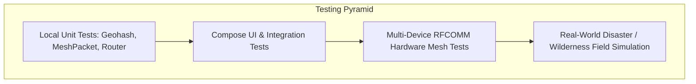

# SurvivE // Emergence AI — Quality Assurance & Testing Strategy Document

## 1. Testing Strategy Overview

SurvivE is designed for safety-critical and life-support emergency environments where software bugs, crashes, or memory leaks can result in catastrophic outcomes. The quality assurance matrix covers four testing tiers:

1. **Local Unit Tests (JVM / JUnit 4):** Deterministic verification of protocols, mathematical algorithms (Haversine, Geohash), and routing state machines.
2. **Instrumented UI Tests (Compose Test / Espresso):** Verification of navigation graphs, touch interactions, Canvas radar rendering, and state restoration.
3. **Hardware-in-the-Loop (HIL) Multi-Device Tests:** Real-world verification of Bluetooth RFCOMM mesh multi-hop relays and PTT voice streaming across physical Android hardware.
4. **Stress & Environmental Field Tests:** Performance verification under low battery, heavy RF interference, thermal throttling, and zero-cellular scenarios.



---

## 2. Automated Local Unit Testing Suite

### 2.1 Navigation & Route Testing
Verified in [`NavigationTest.kt`](file:///C:/Users/umart/OneDrive/Desktop/SurvivE/app/src/test/java/com/example/myapplication/NavigationTest.kt):
- Validates that all defined `Screen` routes (`home`, `manual`, `ai`, `locator`, `bluetooth`, `emergency`) match navigation graph declarations without route mismatch or typos.

### 2.2 Protocol Serialization Unit Tests (`MeshPacketTest`)
Validates binary serialization and deserialization across network streams:
- **Magic Byte Verification:** Ensures packets with magic bytes other than `0xBC` are rejected.
- **Round-Trip Integrity:** Serializing a `MeshPacket` with full telemetry (lat, lon, geohash, payload) to a byte array and parsing back produces an exact match.
- **Boundary Handling:** Correctly handles null coordinates and UTF string encoding.

### 2.3 Mesh Router & Deduplication Tests (`BitChatMeshRouterTest`)
Validates multi-hop routing logic and store-and-forward behavior:
- **Deduplication:** Feeding two identical packets with the same `messageId` results in only one delivery; second packet is dropped.
- **Hop Limit Enforcement:** Packets with `hopCount >= maxHops` trigger no re-broadcast.
- **Store-and-Forward Queue:** Verifies that packets addressed to an offline node remain in `_offlineQueue` and are completely flushed when the node re-appears.

### 2.4 Mathematical Geolocation Tests (`GeohashUtilsTest`)
- **Geohash Accuracy:** Verifies precision-7 Geohash calculation matches reference coordinates.
- **Haversine Distance:** Validates distance calculation between known GPS coordinates against standard GIS ground truth.
- **Bearing Calculation:** Validates azimuth angles (0° = North, 90° = East, 180° = South, 270° = West).

---

## 3. Executing Automated Tests

### 3.1 Running Local Unit Tests via Gradle
```bash
# On Windows PowerShell
.\gradlew.bat testDebugUnitTest

# On macOS / Linux
./gradlew testDebugUnitTest
```

### 3.2 Running Instrumented Device Tests
With a connected Android device or emulator:
```bash
.\gradlew.bat connectedDebugAndroidTest
```

---

## 4. Hardware-in-the-Loop (HIL) Field Testing Protocols

Because Bluetooth RFCOMM, audio recording, and GPS depend directly on physical radio transceivers, developers and QA personnel must execute the following physical test matrix:

### 4.1 Protocol Test: Multi-Device Mesh Communication
- **Equipment:** 3 Physical Android Devices (Device A, Device B, Device C).
- **Setup:** Place Device A and Device C out of direct Bluetooth range of each other, with Device B placed halfway between them as a relay node.
- **Execution Checklist:**
  1. On all devices, navigate to the **Bluetooth** tab and grant all runtime permissions.
  2. Device A connects to Device B. Device B connects to Device C.
  3. Device A broadcasts a message: `"Emergency at Sector 4"`.
  4. Verify that Device B relays the packet (`hopCount = 1`).
  5. Verify that Device C successfully receives the packet with tag `[via 2 hops]`.

### 4.2 Audio Test: Push-to-Talk (PTT) Latency & Intelligibility
- **Setup:** 2 Connected Devices over Bluetooth.
- **Execution Checklist:**
  1. Press and hold **HOLD TO TALK** on Device A.
  2. Speak clearly into the microphone for 5 seconds.
  3. Release the button.
  4. Verify on Device B:
     - Audio begins playing with latency < 500ms.
     - Voice is crisp, audible, and free of buffer stuttering.
     - Releasing the button on Device A immediately stops recording and closes the stream.

### 4.3 On-Device AI: Offline Generation & Thermal Load
- **Setup:** 1 Device with airplane mode enabled (Wi-Fi OFF, Cellular OFF, Bluetooth OFF).
- **Execution Checklist:**
  1. Stage `qwen2_5_0_5b.task` into the app.
  2. Navigate to **Emergence AI**. Tap the chip **"Water Purification"**.
  3. Verify that response begins streaming within 2-4 seconds.
  4. Verify that the response contains concise, numbered, actionable steps with bold warnings.
  5. Monitor CPU temperature and verify device does not crash or suffer excessive thermal throttling during repeated queries.

### 4.4 Navigation: Offline Radar & Vector Maps
- **Execution Checklist:**
  1. Verify GPS coordinates display correctly on the **Home** and **Locator** cards.
  2. Verify Geohash string matches current location.
  3. Switch to **Offline Map** tab. Import a regional `.map` file.
  4. Pan and zoom across the map; verify street lines and terrain render smoothly with zero internet connection.
  5. Tap the **My Location** FAB and confirm the viewport snaps directly to the current GPS fix.

### 4.5 Emergency & Offline Manuals
- **Execution Checklist:**
  1. Enable Airplane mode.
  2. Navigate to **Manual** tab.
  3. Tap **"Open PDF"** for each of the four humanitarian manuals.
  4. Confirm that all four manuals open immediately in the system document viewer with zero errors.
  5. Navigate to **Emergency** tab; pick a contact from the phonebook and confirm it is stored in the active session roster.
  6. Tap **"Launch Emergency Hardware FM"** and confirm that the native vendor FM tuner application opens (if supported by device SoC).
